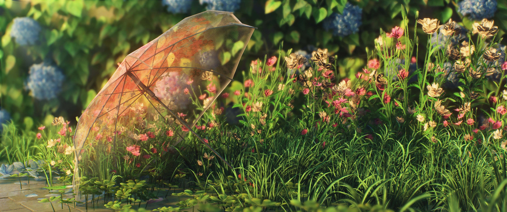

# AllenShiina

### ✦ Developer ·  Sentimental Geek  · Anime Enthusiast

*Building things with curiosity and passion.*

*You know that I will always love Mashiro Shiina！*

---
## 🔗 Links to My Content

🌏 **README Languages:**
[**English**](./README.md) / [**中文**](./README.zh.md) 

### 🎵NetEase Cloud Music
>This is the app I usually use for listening to music. Unfortunately, my account is currently under a ban, so I can only listen to music—social features are disabled.
> [NetEase Cloud Music](https://music.163.com/#/user/home?id=3243211881)

### 📺 Bilibili
> I’ve uploaded some videos, but they’re a bit disorganized; I plan to put together a better plan for them later.
> [Bilibili](https://space.bilibili.com/1685223034)

### ▶️ Youtube
> There are currently no plans for this.
> [Youtube](https://www.youtube.com/@AllenShiina)

---

## 👨‍💻 About Me

- Currently learning **Next.js & TypeScript & C++**
- Interested in Web Development and UI Design
- Currently working in desktop operations/support.
- Love anime, games and technology,highly interested in reverse engineering and network proxy protocols.
Covers a wide range of topics, though not with complete mastery.
- I am a highly emotional person. I generally lack strong motivation for most things; however, when something truly captures my interest, I become so intensely focused—to the point of forgetting to eat or sleep—that I end up spending much of my time simply sleeping. That "something" is computers and programming. Another major part of my life has been occupied by deep reflection and gaming—yes, I’ve been quite immersed in both. Gaming and programming were my companions during the loneliest moments of my life. Now, as times have changed, it is time for me to face life with a more proactive attitude.

## 🛠️ Tech Stack

## 🚀 MY Main-Projects
> 这是一款 Windows 桌面实用程序，用于创建加密的、分卷的7-zip的压缩包，结合多面体文件伪装，并从受密码保护的.fckey密钥中恢复它们。
> - [Fake-Compression](https://github.com/AllenShiina-Mashiiro/Fake-Compression)

> AllenShiina的游戏资源档案网站，用于记录R-18 Games的档案的网站，允许将互联网的资源整合记录手动增添删改
>- [sakura-game-archive](https://github.com/AllenShiina-Mashiiro/sakura-game-archive)

## 📦 Out Of The Box
> A continuously curated development cheat sheet, covering various programming environments, build commands, terminal instructions, version control operations, and packaging/release methods.
- [GitHub-PowerShell_Manual](./assets/Get-command/GitHub-PowerShell_Manual.md)
- [Python-Encapsulation-Template](./assets/Get-command/Python-Encapsulation-Template.md)

## 📊 GitHub Statistics

---

*Thanks for visiting my profile ♡*

